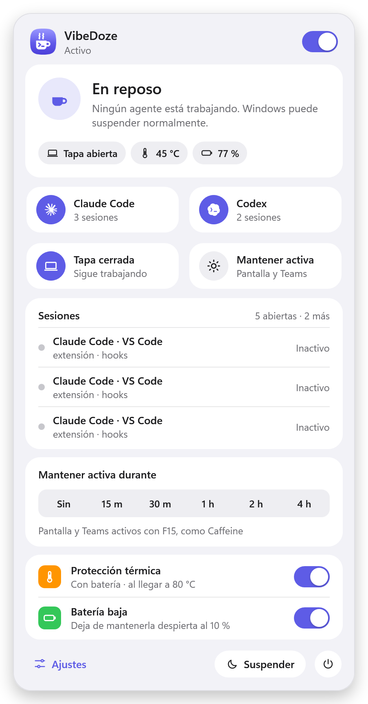
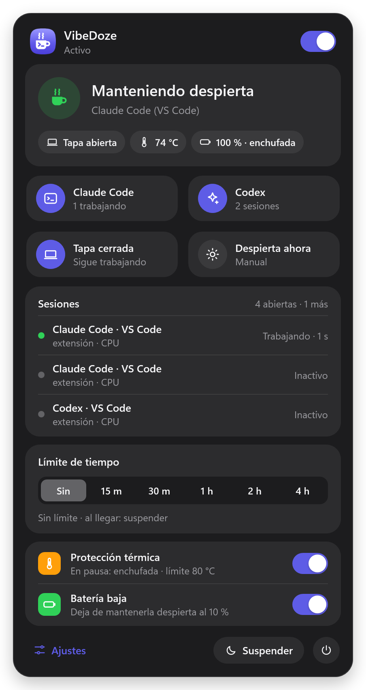
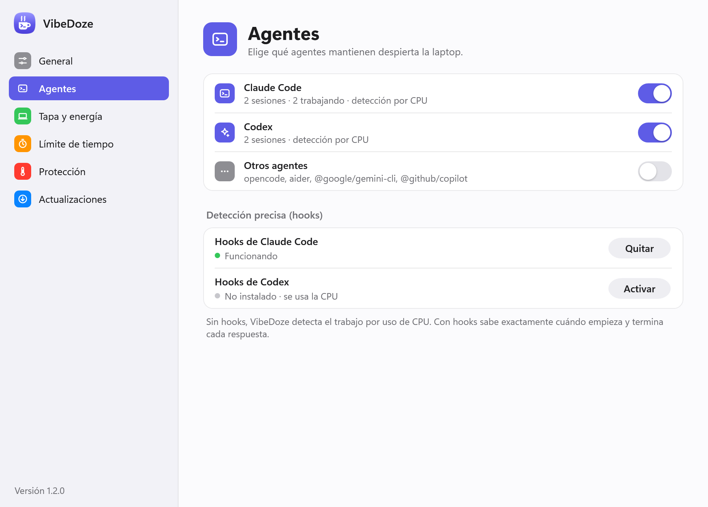
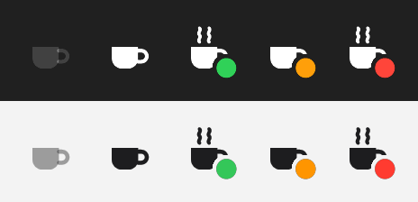
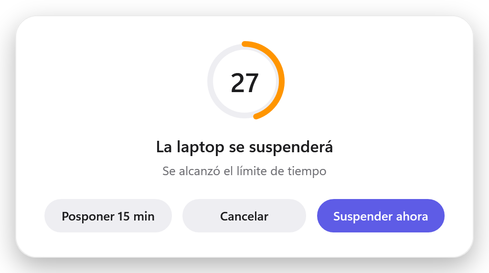

# VibeDoze

App de bandeja para Windows que **mantiene tu laptop despierta mientras Claude Code o Codex están trabajando**, aunque cierres la tapa, y la duerme sola cuando terminan. Incluye *Mantener activa*, que deja la pantalla encendida y tu estado de Teams en Disponible como Caffeine, y protección térmica y de batería, para que no se recaliente dentro de una funda.

Funciona con la extensión de VS Code, Cursor, Windsurf, Antigravity, JetBrains y con cualquier terminal (CLI de `claude` o `codex`), y también con agentes instalados en un servidor al que entras por SSH, como una instancia EC2.

<p align="center">
  
  &nbsp;
  
</p>

## Qué hace

| Función | Detalle |
|---|---|
| **Detección de agentes** | Claude Code y Codex, cada uno con su interruptor. Muestra cada sesión con su IDE o terminal, el proyecto y su estado (trabajando, esperando permiso, terminó). |
| **Tapa abierta** | Mientras un agente trabaja, la pantalla se apaga según tu configuración, pero la laptop no se suspende. Si prefieres que la pantalla siga encendida, activa *Ajustes → Tapa y energía → Mantener la pantalla encendida*. |
| **Tapa cerrada** | Mientras un agente trabaja, cerrar la tapa no suspende la laptop. Cuando termina (más un margen configurable), la laptop se suspende sola. Si la suspendes tú (botón de encendido o *Inicio → Suspender*), se suspende igual aunque un agente esté trabajando: VibeDoze no la mantiene despierta y la luz Slash queda apagada hasta que vuelvas a usarla. |
| **Luz Slash** | En las laptops ROG con barra Slash en la tapa (Zephyrus G14 y G16 desde 2024; en otras laptops no aparece ni toca nada), la barra es una luz de estado: apagada mientras usas la laptop y, con la tapa cerrada, una luz que la recorre mientras un agente trabaja, doble parpadeo si necesita tu respuesta y respiración lenta al terminar. Funciona también con batería. Se prueba en *Ajustes → Tapa y energía → Probar*. Si prefieres tu animación de Armoury Crate con la tapa abierta, desactiva *Apagada mientras usas la laptop*; al salir de VibeDoze también vuelve. |
| **Mantener activa** | Como Caffeine: tras un minuto sin teclado ni mouse pulsa F15, una tecla que ninguna app usa, así la pantalla no se apaga ni se bloquea y Teams, Slack y similares te muestran Disponible. Mientras está activa, cerrar la tapa no suspende la laptop. Elige cuánto dura (15 min, 30 min, 1 h, 2 h, 4 h, 8 h o un valor personalizado): ese tiempo se cumple aunque Claude termine antes. *Sin límite* se desactiva cuando Claude termina. Al desactivarse, la laptop vuelve a suspenderse como siempre (con la tapa cerrada, al momento). Si la laptop se suspende antes, también se desactiva. Con la tapa cerrada también pulsa F15, así Teams te sigue mostrando Disponible, y si usas un monitor externo lo mantiene encendido. |
| **Protección térmica** | Lee los sensores térmicos ACPI de Windows (sin admin). Apenas la temperatura llega al límite o lo supera (80 °C por defecto), suspende o hiberna, sin esperar. Si Windows ya la está suspendiendo (por ejemplo, al cerrar la tapa), le da 75 s para dormirse, porque una laptop dormida se enfría. Si con la tapa cerrada la suspensión no entra en 75 s, hiberna. Con la tapa abierta avisa 30 s antes; si eliges *Ignorar*, la protección queda en pausa 15 min o hasta que cierres la tapa, lo que ocurra primero. Mientras hay agentes trabajando o la tapa está cerrada, el registro anota la temperatura cada minuto. Por defecto **solo actúa con batería**: enchufada es normal que se caliente (cargando, jugando con agentes corriendo). Se puede cambiar con "Solo con batería". |
| **Batería baja** | Por debajo del porcentaje elegido deja de mantenerla despierta y, si la tapa está cerrada, la suspende. |
| **Agentes por SSH** | Claude Code o Codex instalados en un servidor (una instancia EC2, por ejemplo) al que entras por SSH desde la laptop: sus hooks llegan por el mismo túnel SSH. Ver [Agentes en un servidor por SSH](#agentes-en-un-servidor-por-ssh). |

## Descargar

**[⬇ Descargar VibeDoze.exe](https://github.com/xMathyu/VibeDoze/releases/latest/download/VibeDoze.exe)** (Windows 10/11 x64; todas las versiones están en [Releases](https://github.com/xMathyu/VibeDoze/releases))

Es un único ejecutable autocontenido: no hay que instalar .NET ni tener permisos de administrador.

1. Guárdalo donde quieras (por ejemplo, `%LOCALAPPDATA%\Programs\VibeDoze`) y ábrelo.
2. El ejecutable no está firmado, así que Windows SmartScreen puede advertir. Elige *Más información → Ejecutar de todas formas*.
3. Abre **Ajustes** desde el panel. En *General* activa **Iniciar con Windows** y, en *Agentes → Detección precisa (hooks)*, pulsa **Activar** para Claude Code y Codex.

### Actualizaciones automáticas

VibeDoze revisa las [Releases](https://github.com/xMathyu/VibeDoze/releases) de este repo a los 2 minutos de iniciar y luego cada 6 horas.

- Si hay una versión nueva, la descarga en segundo plano (`VibeDoze.zip`, más liviano) y verifica el `.exe` contra `VibeDoze.exe.sha256`. Si no coincide, la descarta.
- La instala sola cuando lleva 2 minutos sin agentes trabajando y sin cambios aplicados a la tapa. Así nunca reinicia en medio de una sesión.
- El reemplazo lo hace `VibeDoze.Hook.exe` cuando VibeDoze ya se cerró. Si algo falla, deja el ejecutable anterior y lo vuelve a abrir.
- En *Ajustes → Actualizaciones* puedes buscar o instalar al momento, o desactivar *Actualizar automáticamente*. El repositorio de origen se cambia con `UpdateRepository` en `settings.json`.

Para publicar una versión nueva:

```powershell
git tag v1.2.0
git push origin v1.2.0
```

GitHub Actions compila y adjunta `VibeDoze.exe`, `VibeDoze.zip` y `VibeDoze.exe.sha256` al release. Las copias instaladas se actualizan solas.

## Instalación desde el código

Requisitos: Windows 10/11 x64. No necesitas permisos de administrador.

```powershell
.\install.ps1 -Hooks all     # compila si hace falta, instala, activa hooks y abre la app
```

- Se instala en `%LOCALAPPDATA%\Programs\VibeDoze` y crea un acceso directo en el menú Inicio.
- Se registra para iniciar con Windows. Usa `-NoStartup` si no lo quieres.
- `-Hooks claude|codex|all|none` activa la detección precisa. También puedes activarla después desde el panel.
- Para compilar se necesita el SDK de .NET 10. `.\build.ps1 -InstallSdk` lo instala en tu perfil si no lo tienes. El resultado es `dist\VibeDoze.exe`, un único ejecutable autocontenido.

Windows 11 oculta los iconos nuevos de la bandeja. Para fijar el de VibeDoze ve a *Configuración → Personalización → Barra de tareas → Otros iconos de la bandeja del sistema*.

## Uso

- **Clic izquierdo** en el icono abre el panel: estado, sesiones, *Mantener activa* y protecciones. Sigue el tema claro u oscuro de Windows.
- **Clic derecho** abre los accesos rápidos: activar o pausar, Claude Code, Codex, tapa cerrada, *Mantener activa*, protección térmica, suspender ahora y salir.
- **Ajustes** (en el pie del panel o en el menú) abre la ventana con todas las opciones, agrupadas en General, Agentes, Tapa y energía, Mantener activa, Protección y Actualizaciones.

<p align="center">
  
</p>

El icono de la bandeja es una taza de café monocroma que combina con la barra de tareas (blanca en tema oscuro, grafito en claro):

<p align="center"></p>

| Icono | Estado |
|---|---|
| Taza sin vapor | En reposo, esperando a que un agente trabaje |
| Taza con vapor y punto verde | Manteniendo despierta |
| Taza con punto ámbar | En espera tras una suspensión automática, o cuenta regresiva |
| Taza con vapor y punto rojo | Alerta térmica |
| Taza atenuada | En pausa |

Si la temperatura llega al límite con la pantalla encendida, aparece una cuenta regresiva de 30 s:

<p align="center"></p>

## Cómo sabe que un agente está trabajando

1. **Procesos.** Busca `claude.exe` (CLI nativo y extensiones), `node … @anthropic-ai/claude-code`, `codex.exe` (CLI y el `app-server` de la extensión) y `node … @openai/codex`. Excluye Claude Desktop. También identifica dónde corre cada agente: VS Code, Cursor, Windows Terminal y otros.
2. **Hooks (recomendado).** Cada evento del agente llega al instante por un *named pipe* a través de `VibeDoze.Hook.exe`, un ayudante de 21 KB que se ejecuta en segundo plano (`async`) y nunca frena al agente.
   - `UserPromptSubmit` / `PostToolUse` → trabajando
   - `PermissionRequest` / `Notification` de permiso → esperando
   - `Stop` / `StopFailure` / `Interrupt` → terminó
   - `SessionEnd` → cerrada
3. **CPU (respaldo sin hooks).** Si el árbol de procesos del agente usa más de ~1.5 % de un núcleo durante unos 9 s seguidos, cuenta como trabajando. No cuentan los picos cortos ni el primer minuto de cada proceso, que es su arranque. Como el modelo puede "pensar" sin usar CPU, en este modo el margen mínimo es de 5 min.
   - La extensión de Codex (VS Code, Cursor…) arranca su `app-server` con cada ventana del editor, aunque no la uses, y su CPU sigue a la interfaz (arranque, abrir el panel, refrescos), no a los turnos. Por eso solo se detecta con hooks: sin ellos aparece como *sin hooks* y no mantiene la laptop despierta.

Notas de los hooks:

- **Claude Code**: se agregan a `~/.claude/settings.json` sin tocar tus otros ajustes ni hooks, y se guarda un respaldo `settings.json.vibedoze-backup`. Los comentarios `//` del archivo no se conservan al reescribirlo; están en el respaldo. Aplican a las sesiones **nuevas**.
- **Codex**: se escriben en `~/.codex/hooks.json`. Codex exige **aprobar los hooks nuevos una vez**, con `/hooks` en la CLI o en la configuración de hooks de la extensión. Funcionan aunque uses el sandbox de Windows de Codex (`[windows] sandbox = "elevated"`). VibeDoze no toca tu `notify`.
- Si un turno se interrumpe sin aviso, se da por terminado tras 10 min sin señales de vida (`HookStaleMinutes`).

## Agentes en un servidor por SSH

Si Claude Code o Codex corren en otra máquina (una instancia EC2, un servidor) y tú entras por SSH, en la laptop solo existe `ssh.exe`. VibeDoze no ve el proceso del agente, y los hooks se ejecutan en el servidor. Para eso está *Ajustes → Agentes → Agentes en un servidor (SSH)*:

1. Activa **Recibir sus hooks por SSH**. VibeDoze escucha en `127.0.0.1:47811`, solo en la laptop.
2. En tu `~/.ssh/config` (`C:\Users\<tú>\.ssh\config`), agrega bajo el `Host` del servidor la línea que muestra Ajustes, y vuelve a conectarte:

   ```
   Host mi-ec2
       HostName ec2-xx-xx-xx-xx.compute.amazonaws.com
       User ec2-user
       RemoteForward 47811 127.0.0.1:47811
   ```

   Sin `~/.ssh/config` sirve `ssh -R 47811:127.0.0.1:47811 ec2-user@servidor`. VS Code Remote-SSH usa el mismo archivo, así que también funciona con la extensión.
3. Con esa conexión abierta, pega en el servidor el comando que copia el botón **Copiar** (lleva un token):

   ```sh
   curl -fsS "http://127.0.0.1:47811/setup?token=…" | sh
   ```

   Crea `~/.vibedoze` (la configuración y `hook.sh`) y agrega los hooks a `~/.claude/settings.json`, y a `~/.codex/hooks.json` si existe, sin tocar el resto. Usa `python3`, que viene en las imágenes de EC2. Aplica a las sesiones **nuevas** de `claude`.

En el panel, cada sesión aparece con el nombre del servidor y *SSH*. El nombre es el `hostname` del servidor; para otro, instala con `… | VIBEDOZE_NAME=mi-ec2 sh`. Para quitarlo: `… | sh -s -- remove`.

Cómo se comporta:

- Cada hook es un `curl` de unos 30 ms, en segundo plano. Sin túnel (SSH cerrado) falla al instante y el agente sigue igual.
- Por SSH no hay CPU que medir. Tampoco llega ningún hook entre que respondes un permiso y el final de esa herramienta. Por eso, si usas el teclado o el mouse de la laptop después de que el agente pidió permiso, VibeDoze lo da por respondido y lo cuenta como trabajando.
- Si el SSH se corta, los avisos dejan de llegar y el turno se da por terminado a los 10 min (`HookStaleMinutes`). Si `claude` corre directo en la sesión SSH, muere con ella; con **tmux** o `screen` en el servidor, el agente sigue aunque la laptop duerma.
- Si abres varias conexiones al mismo servidor, la primera abre el túnel. Las demás avisan `remote port forwarding failed`, sin consecuencias, y sus sesiones usan ese mismo túnel mientras la primera siga abierta.
- Para probar el túnel desde el servidor: `curl http://127.0.0.1:47811/ping`.

## Tapa cerrada y Modern Standby

Para seguir trabajando con la tapa cerrada, VibeDoze cambia temporalmente la acción *"Al cerrar la tapa"* a *"No hacer nada"* en **todos** tus planes de energía. Así se cubre también el caso en que la app del fabricante cambia de plan (Silent, Turbo…). Lo deshace cuando los agentes terminan.

En las laptops con Modern Standby, mientras un agente trabaja, también pone *"Suspender tras inactividad"* en *"Nunca"* en todos tus planes. En ellas no basta con pedirle a Windows que no suspenda: al vencer ese tiempo entra en reposo igual, aunque la tapa esté abierta, y con batería anula el pedido 5 minutos después. La pantalla se sigue apagando según tu ajuste.

Los dos cambios **siempre se restauran**, aunque la app se cierre de golpe:

- Los valores originales se guardan en `state.json` antes de cambiarlos.
- Un *watchdog* (unos 15 MB) los restaura si VibeDoze muere.
- Al iniciar sesión, la app restaura lo que haya quedado pendiente.
- Al apagar o cerrar sesión, Windows avisa a la app y esta también restaura.

La **luz Slash** sigue la misma regla: antes de animarla, VibeDoze guarda en `state.json` la animación, el brillo y los ajustes de la barra, y al terminar los vuelve a escribir tal cual. Para que se vea con la tapa cerrada y con batería activa esas opciones mientras dura, y luego las deja como las tienes en Armoury Crate. Para apagarla mientras usas la laptop usa el mismo interruptor general de Armoury Crate; `VibeDoze.exe restore-lid` (y salir de la app) la vuelve a encender.

Muchas laptops modernas usan **Modern Standby (S0)**; `powercfg /a` te dice si la tuya es una de ellas. En ellas Windows no permite "suspender ahora" por API con la pantalla apagada. Cuando un agente termina con la tapa cerrada, VibeDoze baja temporalmente *"Suspender tras inactividad"* a 1 minuto para que Windows entre en reposo por sí mismo, y restaura el valor al despertar. Si en 2½ minutos la laptop sigue encendida (por ejemplo, porque otra app la mantiene despierta), la **hiberna**. Con la tapa abierta, "suspender" apaga la pantalla, que es lo que activa el Modern Standby.

## Archivos

| Ruta | Contenido |
|---|---|
| `%LOCALAPPDATA%\Programs\VibeDoze\VibeDoze.exe` | La app |
| `%LOCALAPPDATA%\VibeDoze\bin\VibeDoze.Hook.exe` | Ayudante de hooks y watchdog (lo extrae la app) |
| `%LOCALAPPDATA%\VibeDoze\vibedoze.log` | Registro de lo que hizo: cambios de tapa, acciones de energía, transiciones de estado |
| `%LOCALAPPDATA%\VibeDoze\state.json` | Valores originales mientras hay un cambio aplicado |
| `%LOCALAPPDATA%\VibeDoze\update\` | Versión nueva ya descargada y verificada, esperando a instalarse |
| `%APPDATA%\VibeDoze\settings.json` | Ajustes |

Ajustes avanzados, solo editables en `settings.json` (*Ajustes → General → Ajustes avanzados*):

| Clave | Por defecto | Qué hace |
|---|---|---|
| `CpuActiveThresholdPercent` | `1.5` | % de un núcleo que cuenta como "trabajando" |
| `CpuOnlyMinGraceMinutes` | `5` | Margen mínimo cuando no hay hooks |
| `HookStaleMinutes` | `10` | Turno sin señales (hooks ni CPU) → terminado |
| `HookHardCapMinutes` | `30` | Turno sin ningún hook → terminado, aunque haya CPU |
| `UpdateRepository` | `xMathyu/VibeDoze` | De qué repo de GitHub vienen las actualizaciones |
| `WatchOthers` / `OtherAgents` | `false` | Vigila otros agentes por nombre de exe (`opencode`, `aider`) o fragmento de comando (`@google/gemini-cli`) |
| `RemotePort` | `47811` | Puerto de los hooks por SSH: el mismo número en los dos lados del `RemoteForward` |
| `RemoteToken` | (se genera) | Lo envía cada hook del servidor; si lo borras se genera otro y hay que reinstalar en el servidor |

## Línea de comandos

```text
VibeDoze.exe                       abre la app (o su panel si ya está abierta)
VibeDoze.exe --background          inicia solo en la bandeja
VibeDoze.exe --quit                cierra la instancia abierta
VibeDoze.exe restore-lid           restaura la acción de la tapa, la suspensión por inactividad y la luz Slash
VibeDoze.exe slash-preview         muestra las animaciones de la luz Slash (~13 s) y la deja como estaba
VibeDoze.exe install-hooks [claude|codex|all]
VibeDoze.exe uninstall-hooks [claude|codex|all]
VibeDoze.exe snapshot [carpeta] [light|dark]
                                   guarda capturas PNG del panel, los ajustes, la cuenta regresiva y los iconos
```

## Solución de problemas

- **La laptop no se suspende al cerrar la tapa, ni siquiera sin agentes.** Revisa *Ajustes → General → Diagnóstico → Al cerrar la tapa, ahora*. Ejecuta `VibeDoze.exe restore-lid`, o restáuralo a mano: `powercfg /setacvalueindex SCHEME_CURRENT SUB_BUTTONS LIDACTION 1` y `powercfg /setdcvalueindex SCHEME_CURRENT SUB_BUTTONS LIDACTION 1`.
- **La laptop ya no se suspende sola por inactividad, ni siquiera sin agentes.** Ejecuta `VibeDoze.exe restore-lid`, o revisa el tiempo de suspensión en *Configuración → Sistema → Energía y batería*.
- **Codex aparece como "detección por CPU" con los hooks instalados.** Aprueba los hooks en Codex (`/hooks`).
- **Codex en VS Code no mantiene la laptop despierta.** La extensión solo se detecta con hooks: actívalos en *Ajustes → Agentes* y apruébalos en Codex.
- **¿Qué está haciendo?** Abre el *Registro de actividad* en *Ajustes → General → Diagnóstico*. Con una consola de administrador, `powercfg /requests` muestra `VibeDoze: Claude Code trabajando` mientras la mantiene despierta.

## Desinstalar

```powershell
.\install.ps1 -Uninstall
```

Quita los hooks, la entrada de inicio, el acceso directo y los archivos, y deja la acción de la tapa como estaba.

Si usaste el `.exe` descargado, ejecuta `VibeDoze.exe uninstall-hooks` (o pulsa **Quitar** en *Ajustes → Agentes*), apaga *Iniciar con Windows*, sal de la app y borra el exe y las carpetas `%LOCALAPPDATA%\VibeDoze` y `%APPDATA%\VibeDoze`.

## Estructura

```text
src/VibeDoze/           App WPF (.NET 10, autocontenida)
  Core/Engine.cs          lógica principal: despierta, tapa, mantener activa, térmica, batería
  Core/PowerController.cs solicitudes de energía, acción de la tapa, suspender/hibernar
  Core/AgentScanner.cs    detección de agentes por procesos y CPU
  Core/AgentTracker.cs    estado por sesión (hooks + CPU)
  Core/Hooks.cs           servidor del named pipe y ayudante
  Core/Integrations.cs    instalar/quitar hooks de Claude Code y Codex; inicio con Windows
  Core/ThermalMonitor.cs  sensores térmicos ACPI (contadores PDH)
  Core/SlashLight.cs      animación de la barra Slash (ROG) por HID y su restauración
  UI/                     panel, ajustes, cuenta regresiva, icono de bandeja, tema claro/oscuro
scripts/make-icon.ps1   genera el icono de la app (Assets/VibeDoze.ico)
docs/                   capturas del README (VibeDoze.exe snapshot)
src/VibeDoze.Hook/      Ayudante de hooks y watchdog (.NET Framework 4.8, 21 KB)
```
